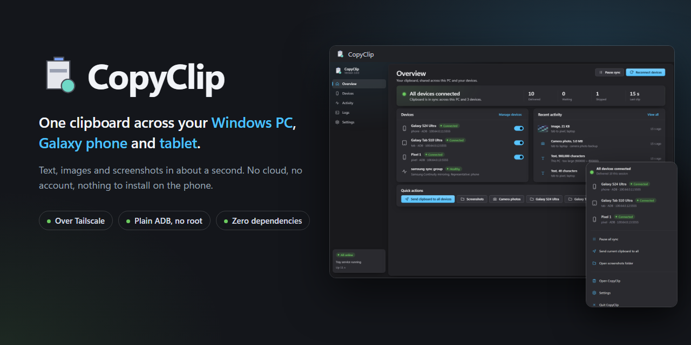
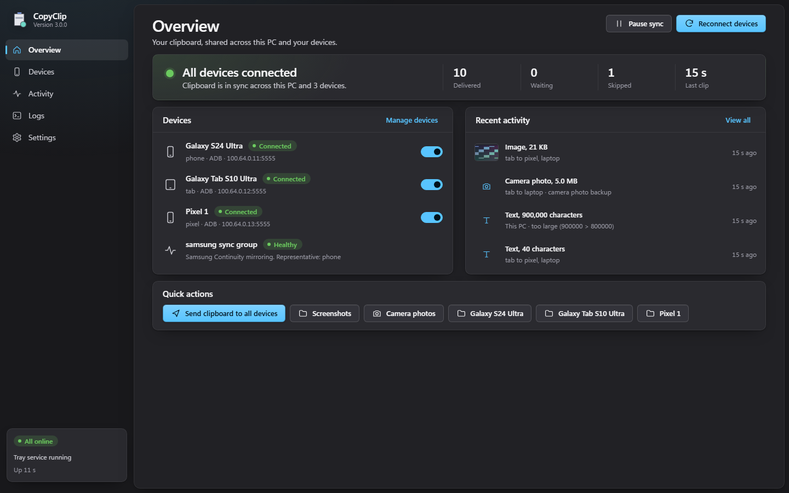
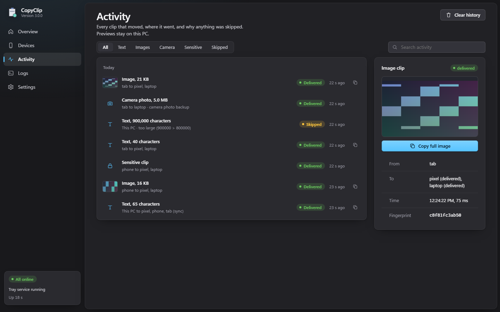
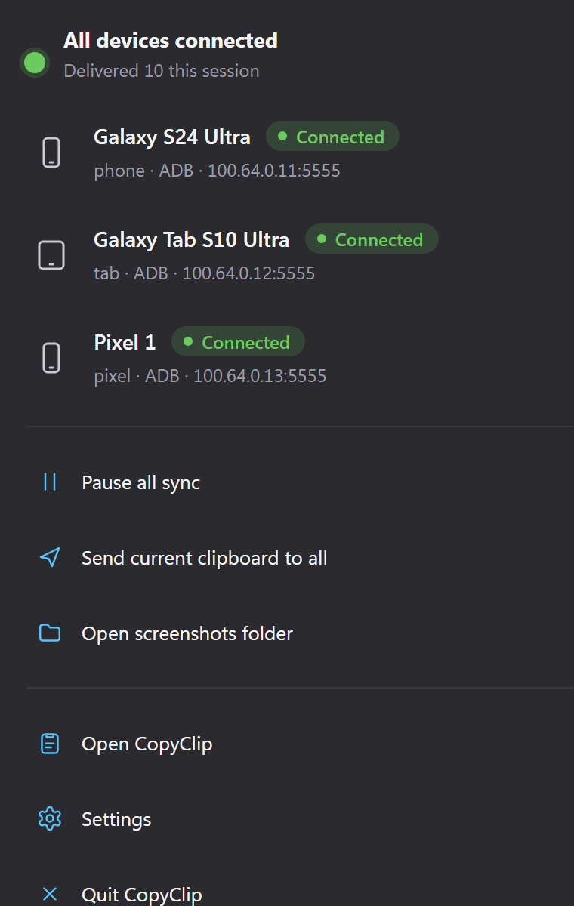
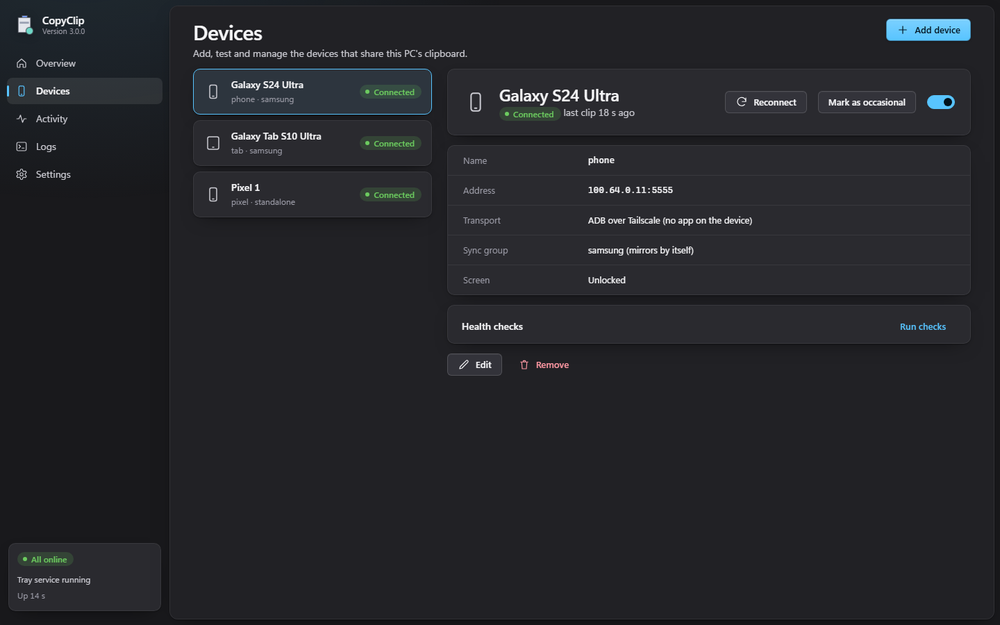
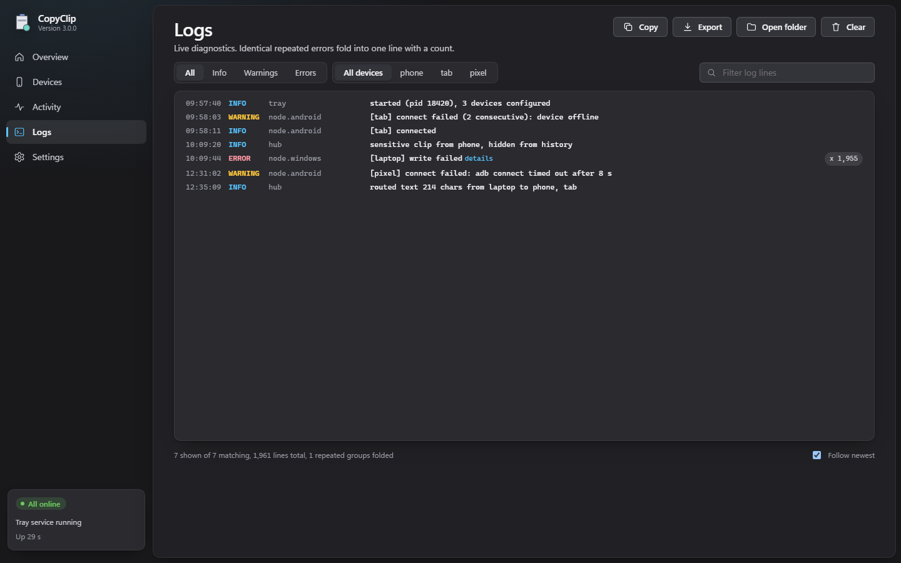
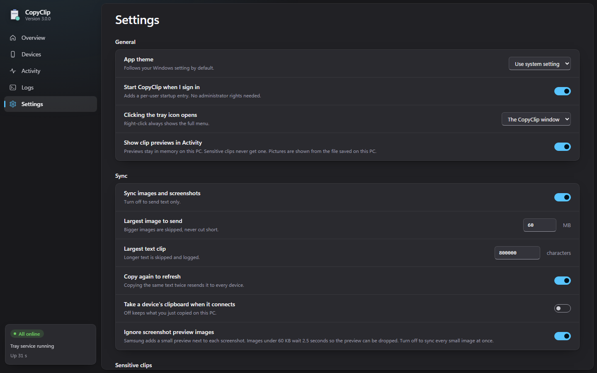

# CopyClip



**One clipboard across your Windows PC, your phone, your tablet and any other Android device. No cloud, no account, no app on the phone, no pip dependencies.**

Copy on any device, paste on any other. Text, images and screenshots, with a modern Windows window for status, history and settings.

```
copy on the PC     ->  every device has it
copy on a phone    ->  the PC and every other device have it
copy a screenshot  ->  pasteable everywhere, and saved to a folder on the PC
```

> Status: used daily since August 2026 on one Windows 11 PC with a Galaxy phone, a Galaxy tablet and an old Pixel. The documented history of what broke and how it was fixed is in [docs/bugs](docs/bugs/README.md).

## The Windows app



A small tray service keeps clipboards in sync. Click the tray icon to open the CopyClip window (Windows 11 style, follows your light or dark setting, keyboard accessible, readable at any display scale).

| Screen | What it does |
| :--- | :--- |
| **Overview** | One-glance health ("All devices connected"), delivered / waiting / skipped counts, every device with a sync switch, recent clips, quick actions, and a clear banner with a Retry button when a device is unreachable |
| **Devices** | List and detail for each device, health checks (ADB reachable, authorised), add, edit and remove with a built-in connection test, sync groups for devices that already mirror each other |
| **Activity** | Every clip that moved: where it came from, where it went, how long it took, and the reason when it was skipped. Text previews stay in memory on the PC; sensitive clips never get a preview. Every text or picture row has a copy button at its right end, and pictures show as thumbnails with a **Copy full image** button in the detail panel |
| **Logs** | Live log with level, device and text filters, repeated errors folded into one line with a count, copy, export and archive |
| **Settings** | Everything configurable, with inline validation, an unsaved-changes bar, and a "Needs restart" tag on the few settings that cannot apply live |
| **Tray menu / flyout** | Pause for 15 minutes, 1 hour or until resumed, per-device pause, send the current clipboard, recent pictures you can copy again, open the screenshots folder, quit. Optionally a compact flyout instead of the window |

To see every screen without any device attached:

```bash
python tools/demo_ui.py --open        # add --degraded to see an offline device
```

| Activity with picture history | Tray flyout |
| :--- | :--- |
|  |  |

| Devices | Logs | Settings |
| :--- | :--- | :--- |
|  |  |  |

These screenshots come from `tools/demo_ui.py` with made-up devices and pictures. Nothing in them is real data.

The window is a separate process: a chromeless app window of a Chromium browser you already have, in its own private profile, so it has its own taskbar entry and the CopyClip icon and never mixes with your browsing. CopyClip uses your default browser if it is Chromium based (Brave, Chrome, Edge, Vivaldi, Opera), then tries Edge, Brave and Chrome, and only then a normal browser tab. It is a single window by design: clicking the tray icon restores and focuses it, however fast you click, and never opens a second one. If it ever crashes or is closed, clipboard sync in the tray is untouched. See [BUG-018](docs/bugs/BUG-018-dashboard-tcl-crash-takes-down-sync.md) for why that matters.

## What is different about it

- **Nothing to install on the phone.** The on-device helper (`ClipBridge`) runs as Android's shell user over a plain `adb` connection, the same mechanism `scrcpy` uses. No root, ever. An optional small Android app exists only for manual "Send Clip" from a device that cannot be reached.
- **Built around how Samsung actually behaves.** Samsung Continuity already mirrors a phone and a tablet, so CopyClip writes to one of them and lets Samsung distribute, then checks that the echo arrived and falls back to writing both if it did not. The clip's identity is its content hash, because Samsung rewrites clip labels.
- **A locked phone cannot receive clips.** Android denies clipboard access under the lock screen. CopyClip queues the clip in a durable outbox and delivers it the moment you unlock, instead of losing it.
- **Careful with sensitive clips.** One-time codes and password-manager copies are dropped by default. If you opt in, they stay out of Windows clipboard history and cloud sync, are never written to disk, and clear themselves after a timer.
- **Zero third-party dependencies**, on purpose, so the sync path stays small and cannot be taken down by a package. Pure Python standard library on the PC; the on-device helper is one readable Java file built with the Android SDK.
- **Measured, not assumed.** Every behaviour above comes from a device experiment written up in [docs/bugs](docs/bugs/README.md) before the code was built on it.

### Measured performance

120 benchmark runs across 12 device pairs over a Tailscale mesh. Details: [docs/sessions/SESSION-2026-09-04.md](docs/sessions/SESSION-2026-09-04.md).

| Content and path | Average (median) | Best |
| :--- | ---: | ---: |
| Android to PC write (text) | 0.2 ms (0.1 ms) | 0.1 ms |
| PC to phone (text) | 391 ms (364 ms) | 317 ms |
| PC to tablet (text, via Samsung) | 348 ms (319 ms) | 283 ms |
| Phone screenshot to PC | 842 ms (835 ms) | 728 ms |
| Tablet screenshot to PC | 1,128 ms (1,082 ms) | 985 ms |
| Idle Android CPU | 0.0% | 0.0% |

Largest verified text clip: 93,247 characters, byte exact, including emoji, Devanagari, tabs and CRLF. The default cap is 800,000 characters.

## Requirements

- Windows 11 and Python 3.11 or newer (nothing to `pip install`).
- [Tailscale](https://tailscale.com) on the PC and the devices, so they can reach each other.
- Android devices with Wireless debugging turned on, and `adb` (Android platform-tools) on the PC.
- A Chromium based browser for the window (Edge ships with Windows 11; Brave and Chrome work too). Without one, a normal browser tab is used.
- The Android SDK to build the on-device helper once: `powershell -File android\build_dex.ps1`.

## Quick start

```bash
# 1. Your own settings. config.json is git-ignored; it never gets committed.
copy config.example.json config.json
#    edit config.json: your device names and Tailscale addresses (or use the Devices screen later)

# 2. Build the on-device helper (once, and after editing android/ClipBridge.java)
powershell -File android\build_dex.ps1

# 3. Check connectivity
python copyclip.py --status

# 4. Run it: tray icon plus window, and it starts at sign-in on its own
python windows_app\tray.py
```

Full runbook, including phone setup and the optional tiers: [SETUP.md](SETUP.md). A start-menu shortcut: `powershell -File windows_app\create_shortcut.ps1`.

## Configuration

Most settings change live from the window. Everything is validated before it is saved, and `config.json` is written atomically, so a bad value can never leave a half-written file. A problem is reported in plain words, all at once.

| Key | Meaning | Applies |
| :--- | :--- | :--- |
| `devices[]` | `name`, optional `label`, `transport` (`adb` or `tcp`), `device` (address and port), `enabled` | restart |
| `domains[]` | Devices that mirror each other by themselves (Samsung Continuity) | restart |
| `hub_ip` | This PC's Tailscale address as the devices see it. Empty detects it automatically | restart |
| `push_port` | Port devices dial in to for "Send Clip" (1024 to 65535) | restart |
| `allow_images`, `max_image_bytes` | Whether images sync, and the largest one. Oversized images are skipped and logged, never cut short | live |
| `max_chars`, `denylist_regex`, `allow_non_text` | Text size cap (skipped whole, never truncated), patterns that must never sync | live |
| `allow_recopy` | Copying the same text again resends it everywhere | live |
| `filter_screenshot_previews` | Samsung adds a small preview image next to each screenshot. `true` holds images under 60 KB for 2.5 seconds and drops the preview if the full picture follows, so it never shows up as a clip of its own | live |
| `adopt_on_connect` | `false` keeps a reconnect from overwriting what you just copied with a device's older clip | live |
| `allow_sensitive`, `sensitive_wipe_s`, `direct_password_sync` | Sensitive clips: opt-in, the auto-clear timer, and the explicit "keep in history" mode | live |
| `screenshot_backup_dir`, `screenshot_backup_include_devices`, `screenshot_device_subfolders`, `device_screenshot_paths`, `screenshot_exclude_from_history` | Where screenshots are saved, per-device folders, and keeping synced images out of Win+V history | live |
| `camera_backup`, `camera_backup_dir`, `camera_device_subfolders` | Back up camera photos from your devices | live |
| `ack_timeout_s` | How long a write waits for the device's confirmation | live |
| `autostart`, `activity_previews`, `tray_left_click` | Start at sign-in, clip previews in Activity, what a tray click opens | live |
| `log_level` | `DEBUG`, `INFO`, `WARNING` or `ERROR` | restart |

Devices are addressed by raw Tailscale IP, never by name, which avoids DNS resolution problems on a tailnet.

## Privacy and security

- **Everything stays on your devices and your tailnet.** There is no server and no account.
- **The window talks to the tray over loopback only.** The control API binds to `127.0.0.1`, needs a random per-run token, rejects foreign `Host` and `Origin` headers, and serves a fixed list of files. These rules are tested in [tests/unit/test_control_api.py](tests/unit/test_control_api.py).
- **The shared key never leaves your machines.** `copyclip.key` and any `*.key` are git-ignored. Authentication between the PC and a device is a mutual HMAC-SHA256 challenge before any clipboard data is processed.
- **Nothing personal is published.** `config.json`, logs, runtime state and local AI-assistant config are git-ignored. `python tools/privacy_scan.py` checks the repository for private IPs, personal paths, email addresses and secrets, and a unit test fails if it finds any. Details: [SECURITY.md](SECURITY.md).

Sensitive clips in more detail: Android apps tag one-time codes and passwords with `EXTRA_IS_SENSITIVE`. By default those clips are dropped at the device. With `allow_sensitive` on, they sync with `CF_CAN_INCLUDE_IN_HISTORY = 0` and `CF_CAN_UPLOAD_TO_CLOUD = 0` on Windows, stay in memory only (never in `outbox.json`), and clear after `sensitive_wipe_s` seconds. Copying anything else first cancels the pending clear.

## Testing and reliability

```bash
python tools/run_tests.py                                  # 290+ unit tests, about 15 seconds, no devices, no clipboard
COPYCLIP_SYSTEM_TESTS=1 python tools/run_tests.py --system # real Windows clipboard, with the tray app closed
COPYCLIP_DEVICE_TESTS=1 python tools/run_tests.py --device tests/test_e2e.py   # real devices
```

- Three tiers keep fast tests safe: unit tests never touch the clipboard or a device; the system tier refuses to run while CopyClip is running (it would sync test clips to your phones); the device tier needs an explicit opt-in. See [tests/README.md](tests/README.md).
- Tests cover the wire protocol byte for byte, the HMAC framing (replay, tampering, malformed frames), the push listener and TCP transport over loopback, device reconnect supervision, the outbox and dedup, configuration validation, the control API's security rules, and the layering of the code itself.
- Twenty-one documented bugs and device spikes, each with the evidence that found it, are in [docs/bugs](docs/bugs/README.md). A bug stays open until it is confirmed fixed in real use, not just when a test passes.
- Session logs from the work are in [docs/sessions](docs/sessions).

## Troubleshooting

**A device shows Offline.** The Overview banner shows the last error and a Retry button. After a phone reboot, wireless debugging may need re-arming once with the device on USB: `adb -d tcpip 5555`. Each device reconnects on its own, so one offline device never stops the others.

**Nothing arrives and the log shows a lock.** Android blocks clipboard access while locked. The clip waits in the outbox and applies on unlock. This is not a bug.

**A synced screenshot is missing from Win+V but pastes fine.** That is the default of `screenshot_exclude_from_history`: a large image was found to evict your other history entries. Turn it off in Settings to list synced images, and accept the eviction risk. See [BUG-005](docs/bugs/BUG-005-duplicate-screenshot-push.md).

**Health check from a terminal:** `python copyclip.py --status`. If CopyClip is running it asks the running service instead of starting a second one.

**The window does not open.** The tray tries each browser in turn and logs what happened to `logs\copyclip.log` (look for `copyclip.launcher`). Run `python windows_app\tray.py --legacy-ui` to use the old Tk window, and see the log in `logs\copyclip.log`.

## Project layout

```
CopyClip/
  copyclip.py              command-line entry point and wiring
  winclip.py, winimage.py  Windows clipboard and image formats (raw ctypes, no dependencies)
  config.example.json      copy to config.json and edit; config.json is never committed
  windows_app/
    tray.py                tray icon, menus, starts everything
    service.py             what the window can ask the tray to do
    control_api.py         local JSON API on 127.0.0.1 with a per-run token
    launcher.py            opens the window (one window only) and the flyout
    ui/                    index.html, app.css, app.js: the window itself
  core/                    routing hub, config, dedup, outbox, policy, activity log, image header reader
  nodes/                   one adapter per device kind: Windows clipboard, Android ClipBridge
  transports/              adb, TCP, push listener, HMAC framing
  domains/                 Samsung Continuity awareness
  android/                 ClipBridge source (Java) and build script
  android_app/             optional Android app for the manual Send Clip fallback
  tools/                   run_tests.py, privacy_scan.py, demo_ui.py, banner/, device audit
  tests/                   unit/ (no devices), system tier, device tier
  docs/                    bugs/, sessions/, images/, PUBLISHING.md
```

Further reading: [ARCHITECTURE.md](ARCHITECTURE.md) (why the code is shaped this way), [SETUP.md](SETUP.md), [CONTRIBUTING.md](CONTRIBUTING.md), [docs/PUBLISHING.md](docs/PUBLISHING.md).

## Acknowledgements

CopyClip stands on the work of others, and several of its decisions were made by reading their source:

- **[scrcpy](https://github.com/Genymobile/scrcpy)** by Genymobile: the technique of reaching Android's clipboard as the shell user through `app_process`, which is the foundation of ClipBridge.
- **[Shizuku](https://github.com/RikkaApps/Shizuku)** and **Shizuku-API** by RikkaApps: the model for privileged helpers without root, and the reference for the optional Android app.
- **[ClipCascade](https://github.com/Sathvik-Rao/ClipCascade)**, **[KDE Connect](https://github.com/KDE/kdeconnect-android)**, **[clipper](https://github.com/majido/clipper)**, **[AdbClipboard](https://github.com/PRosenb/AdbClipboard)** and **[ClipboardHelper](https://github.com/Potato-DiGua/ClipboardHelper)**: prior art whose designs and limits shaped what CopyClip does differently. What each contributed is recorded in [otherCopyProjects/NOTES.md](otherCopyProjects/NOTES.md).
- **[Tailscale](https://tailscale.com)** for the private network that makes direct device addressing safe.

Thanks to everyone who maintains those projects.

## Roadmap

Designed for, deliberately not built yet: file transfer via Taildrop, searchable clipboard history, and more devices per group. See [ARCHITECTURE.md](ARCHITECTURE.md#12-future-scope-designed-for-not-built).

## License

Licensed under the Apache License 2.0. See [LICENSE](LICENSE) and [NOTICE](NOTICE).

## Contact

Questions and private security reports: contact@mohitarora.me. See [SECURITY.md](SECURITY.md).
